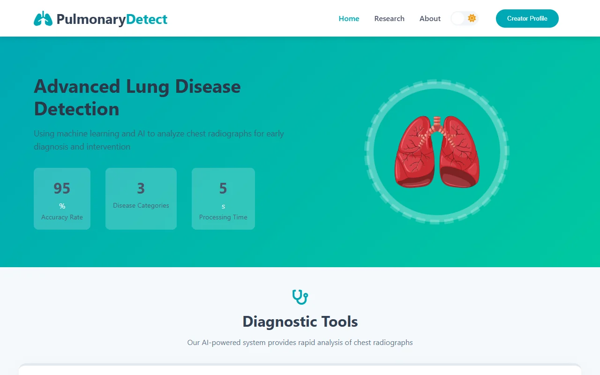

# PulmonaryDetect — AI Lung Disease Detection

Aplikasi deteksi penyakit paru-paru berbasis citra X-Ray (**Normal, Pneumonia, Tuberkulosis**) dengan inferensi AI **100% di sisi browser via TensorFlow.js** sehingga privasi citra medis terjaga.

🔗 **Live Web:** [`https://pulmonarydetect.gimmhost.my.id/`](https://pulmonarydetect.gimmhost.my.id/)

<table>
  <tr>
    <td width="40%" valign="top">
      <h3>Evaluasi Model (MobileNet)</h3>
      <table>
        <tr><td><b>Accuracy</b></td><td><b>99.51%</b></td></tr>
        <tr><td><b>F1-Score (Macro)</b></td><td><b>99.51%</b></td></tr>
        <tr><td><b>ROC-AUC</b></td><td><b>0.9999</b></td></tr>
        <tr><td><b>Input Support</b></td><td>PNG, JPG, <b>DICOM</b></td></tr>
      </table>
      <p><b>Stack:</b> Python · Flask · TensorFlow.js · Vanilla CSS (Dark/Light Mode)</p>
    </td>
    <td width="60%" valign="middle">
      
    </td>
  </tr>
</table>

### Menjalankan Lokal

```bash
python -m venv venv && venv\Scripts\activate
pip install -r requirements.txt
python app.py
```
